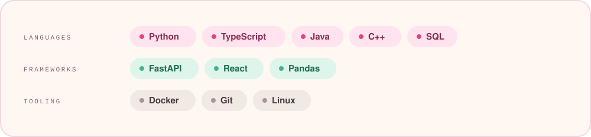

<div align="center">



<br/>

<a href="https://linkedin.com/in/amina-karmenova"></a>
<a href="https://github.com/am1nkv"></a>


</div>

<br/>

### ✈️ &nbsp;Now boarding

- 🎓 &nbsp;**Master MIAGE** (Business Informatics) at **Paris Dauphine–PSL**
- 🛫 &nbsp;**Apprentice Decision Support Engineer** at **Air France-KLM**
- 🧠 &nbsp;Heading towards **AI & data** — one commit at a time
- 💬 &nbsp;Ask me about Python, data, fullstack, DevOps… or a good book

<br/>

### 🧳 &nbsp;Carry-on

```python
from dataclasses import dataclass


@dataclass(frozen=True)
class Amina:
    handle: str = "am1nkv"
    studying: str = "Master MIAGE @ Paris Dauphine-PSL"
    working: str = "Apprentice SWE @ Air France-KLM"
    speaks: tuple = ("French", "English", "Russian", "Kazakh")
    into: tuple = ("AI", "Data", "Fullstack", "DevOps", "Books", "Sports")
    fun_fact: str = "I'm afraid of C... 🏃‍♀️"

    def say_hi(self) -> None:
        print("Thanks for stopping by! Let's build something cool together :D")


Amina().say_hi()
```

<br/>

### 🛠️ &nbsp;Tech stack



<br/>

### 📊 &nbsp;Flight log

<div align="center">
  
  
  <br/>
  
</div>

<br/>


